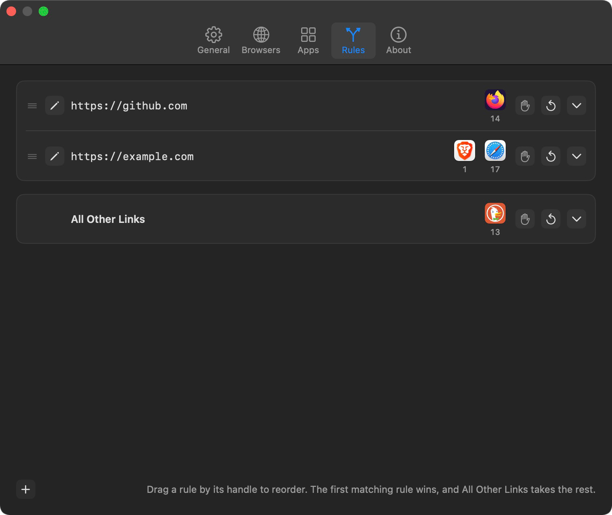

# Browserino



Browserino is a small, native browser picker for macOS, written in SwiftUI. Set it as your default browser, and every link you click goes through it. Browserino then opens the link in the right browser, profile or app by your rules, or shows a quick picker so you can choose.

> **This is a modified fork** of [AlexStrNik/Browserino](https://github.com/AlexStrNik/Browserino), created by [@misku](https://github.com/misku) and changed from 2026 onwards. Version 2.0 adds multi-browser rules, a redesigned Settings window, Firefox containers and many fixes. Like the original, it is licensed under the [GNU GPL v3](LICENSE).

## What's new in 2.0

- **Rules can name several browsers.** One browser opens the link directly; two or more show the picker with only those. A rule can also simply show the full picker.
- **All Other Links**: a fixed last rule for every link no rule matched.
- **Choose a rule's browsers inline.** Each rule row has a checkbox list of your browsers, a private window toggle, and a Reset button.
- **Firefox containers**: each container in your default Firefox profile is a browser of its own.
- **A redesigned Settings window**: native toolbar tabs, drag handles, tooltips on every button, and clearer forms.
- **Private windows work out of the box** with the known flags of Chrome, Brave, Edge, Firefox and others.
- **Safer settings**: rules are kept readable by older versions, an unreadable entry no longer wipes a list, and imports are checked before anything is written.
- **Fixes**: the picker can no longer crash on an empty list, shortcut keys are limited to letters and digits, and settings apply the moment they change.

## Installation

### Download

1. Download the latest `Browserino-v….zip` from this fork's [Releases page](https://github.com/misku/Browserino/releases).
2. Unzip it and move `Browserino.app` to `/Applications`.
3. The app is not notarized, so macOS asks you to confirm the first launch. Right-click `Browserino.app`, choose **Open**, then **Open** again. If macOS still refuses, run:

   ```bash
   xattr -dr com.apple.quarantine /Applications/Browserino.app
   ```

The original author's Homebrew tap and Releases page install the original 1.x app, which doesn't have the features below.

### Build from source

You need Xcode 26 or later.

```bash
git clone https://github.com/misku/Browserino.git
cd Browserino
xcodebuild build -project Browserino.xcodeproj -target Browserino -configuration Release
```

The app is built into `build/Release/Browserino.app`. You can also open `Browserino.xcodeproj` in Xcode and run it from there.

### Requirements

- macOS 14 Sonoma or later.
- Firefox containers need the free Firefox extension [Open external links in a container](https://addons.mozilla.org/en-US/firefox/addon/open-url-in-container/).

### Note for users of the original app

The fork uses the same app identifier as the original Browserino. Installing it replaces the original and keeps all its settings. Going back to 1.x also works, but 1.x sees each rule with only its first browser, and a rule set to show the picker opens your first visible browser instead.

## Getting started

1. Open Browserino. The first launch opens Settings.
2. In **General**, click **Make Default** so links go through Browserino.
3. In **Browsers**, put your browsers in the order you want them in the picker, hide the ones you never use, and give your favourites a shortcut key.
4. Click any link. The picker appears next to the pointer.
5. Add **Rules** for links that should always go to the same browser.

## The picker

The picker lists your visible browsers, and Apps that match the link, next to the pointer.

| Key | Action |
|---|---|
| Return | Open in the highlighted browser |
| Shift-Return | Open in a private window |
| Up / Down | Move the highlight |
| A letter or digit | Open in the browser with that shortcut |
| Shift and the letter or digit | Open that browser in a private window |
| Escape | Close the picker without opening the link |
| Option-Command-C (or Command-C) | Copy the link |

You can also click a browser, or Shift-click it for a private window. The host of the link is shown at the bottom; clicking it copies the whole link.

When a rule has its private window setting on, a filled hand next to the host says so, Return opens a private window, and Shift opens a normal one.

## Rules

A rule sends links that match a pattern to the browsers you choose. Rules are tried from top to bottom, and the first match wins.

Each rule row shows:

- a **drag handle** to reorder the rule. Right-click the handle for Move Up, Move Down, Move to Top, Move to Bottom, Edit Rule, Show Picker and Delete Rule.
- an **edit button** (or click the pattern) to change the pattern and port.
- the rule's **browsers** as icons, with each browser's number from the Browsers tab underneath. Hover over them to see their names.
- a **private window** toggle (the hand).
- a **Reset** button, which clears the chosen browsers so the rule shows the full picker.
- a **chevron** that opens the rule's list of browsers. Check the ones the rule should use.

What a matching link does depends on the rule's browsers:

| Browsers | Result |
|---|---|
| None (after Reset, or a new rule) | The full picker, as if no rule matched, except that All Other Links is skipped |
| One installed | Opens directly in that browser |
| Two or more installed | The picker with only those browsers, in Browsers order |
| None of them installed | The full picker |

### Patterns

A rule's **Regex Pattern** is a regular expression, matched anywhere in the full link and ignoring case. Most URL characters mean themselves, but a few have special meanings:

- `.` matches any character. Write `\.` for a literal dot.
- `?` makes the previous character optional. Write `\?` for a literal question mark, for example in a query string.
- `^` anchors the pattern at the start of the link.

| Pattern | Matches |
|---|---|
| `^https://github\.com/myorg/` | one GitHub organisation |
| `^https://([a-z0-9-]+\.)*tailscale\.com/` | tailscale.com and all its subdomains |
| `zoom\.us/j/` | Zoom meeting links |
| `^https?://localhost(:\d+)?/` | localhost on any port |

The rule sheet has a **Test Links** box: paste links, one per line, and each shows a check if the rule would take it. A rule can also require a **port**. Links without a port count as 80 for http and 443 for https.

A rule listed after one that matches every link is marked **Never used**.

### All Other Links

The last row takes every link that no rule matched. With no browsers chosen, it shows the full picker. With browsers chosen, it works like a rule. If an App also matches the link, the picker shows the App alongside those browsers, so the App stays reachable.

### How a link is routed

1. The first rule that matches decides, as described above.
2. If no rule matches, an App bound to the link's host opens directly when **Open app links without asking** is on in General.
3. Otherwise All Other Links applies.

Several links opened at once skip the rules and show the picker.

## Browsers

The Browsers tab lists every browser Browserino found, one row per Chromium profile and per Firefox container. Each row has:

- a **number**, used in rules and the picker;
- a **name** you can change by clicking it; clear it to go back to the default;
- a **private flag** passed to the browser for private windows. Leave it empty to use the known flag: `--incognito` for Chrome, Brave, Vivaldi and other Chromium browsers, `--inprivate` for Edge, `--private-window` for Firefox. Safari can't open private windows this way;
- a **shortcut key** (letters and digits only). While recording, Escape cancels and Delete removes the shortcut;
- an **eye** to hide the browser from the picker. Rules can still use hidden browsers.

Drag a row by its handle to change the picker order. **Rescan** looks for new browsers and profiles, and **Search Locations** sets the folders Browserino searches. `/Applications` is always searched.

### Chromium profiles

Chrome, Brave, Edge, Vivaldi, Arc, Opera and other Chromium browsers with several profiles get one row per profile, with the profile's picture on the icon. If macOS keeps the profile list private, a banner offers **Allow Access…**: choose the browser's folder once, and Browserino remembers it.

### Firefox containers

Each container in your default Firefox profile appears as its own row, such as **Firefox: Work**, with the container's colour and icon on the Firefox icon. Firefox itself can't be asked to open a container, so Browserino relies on the free extension [Open external links in a container](https://addons.mozilla.org/en-US/firefox/addon/open-url-in-container/). The Browsers tab shows whether it's installed and offers a **Get Extension…** button. Firefox's built-in containers (Personal, Work, Banking, Shopping) are matched by their English names. A private window can't use a container, so a private open uses a normal private window. Firefox only lets the extension open web links, so a `file://` or other non-web link sent to a container opens in a normal Firefox tab. Zen, LibreWolf and Waterfox are supported the same way.

## Apps

An App opens links to a host in a specific app, such as `zoom.us` in Zoom. Matching Apps appear in the picker, above or below the browsers, as set in General. An App can also **replace the link's scheme**, for apps that register their own, such as `zoommtg` for Zoom. Leave the host empty to offer the App for every link.

## General

- **Default browser**: shows whether Browserino is the default, with a **Make Default** button.
- **Picker**: show Apps above browsers, open App links without asking, close the picker after copying the link, and the copy shortcut.
- **Startup**: show Browserino in the menu bar, and open it at login. When the menu bar icon is hidden, open Browserino from Applications to get back to Settings.
- **Settings**: **Export…** saves your settings to a file. **Import…** replaces them with a file's, after checking every setting first; settings the file doesn't have go back to their defaults. **Reset…** erases all settings, after a confirmation.

## The browserino:// scheme

Other tools can send a link through Browserino with `browserino://open?url=` followed by the link, Base64-encoded:

```bash
open "browserino://open?url=$(printf 'https://example.com' | base64)"
```

## Privacy

Browserino makes no network requests. It reads your browsers' profile and container lists locally to show them, and passes each link only to the browser or app you choose.

## Development

- SwiftUI with an AppKit app delegate, Swift 6, macOS 14 deployment target.
- Every push is built by GitHub Actions on a macOS 26 runner. A failed build lists its first compiler errors as annotations on the run.
- Pushing a tag such as `v2.0.0` builds the app and publishes it on a GitHub Release.

## Credits

Browserino was created by [@AlexStrNik](https://github.com/AlexStrNik). If you like it, you can support the original author on [Gumroad](https://alexstrnik.gumroad.com/l/browserino).

Thanks to [@matijazezelj](https://github.com/matijazezelj), [@xplorick](https://github.com/xplorick), [@byt3m4st3r](https://github.com/byt3m4st3r), [@mihado](https://github.com/mihado), [@ventz](https://github.com/ventz), [@sayre4ux](https://github.com/sayre4ux), [@mihai97ionita](https://github.com/mihai97ionita), [@webcoyote](https://github.com/webcoyote), [@simonswine](https://github.com/simonswine) and others for their contributions.

Inspired by [Browserosaurus](https://github.com/will-stone/browserosaurus).

## License

GNU General Public License v3.0. See [LICENSE](LICENSE).
